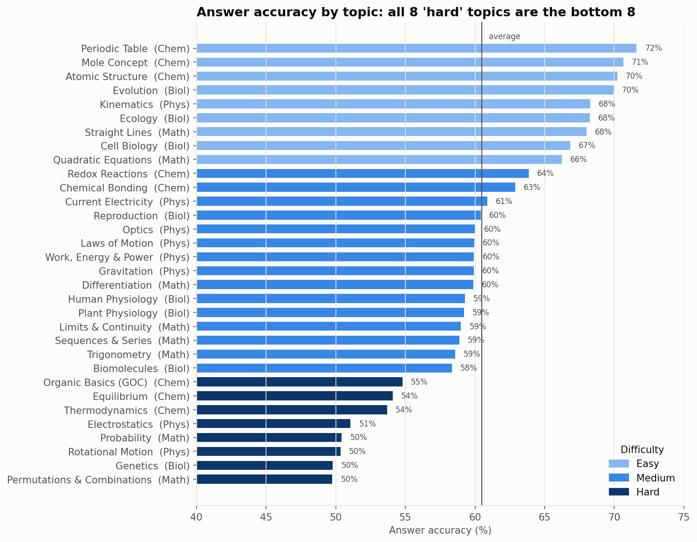
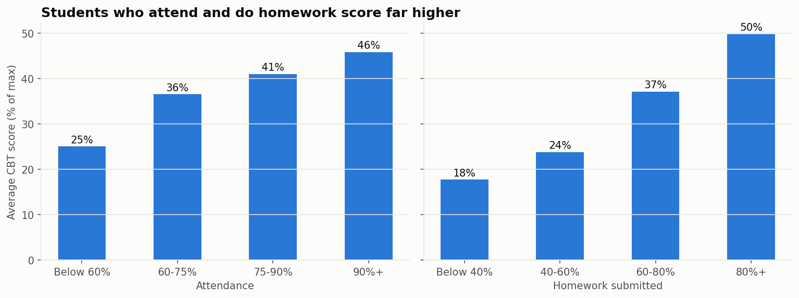
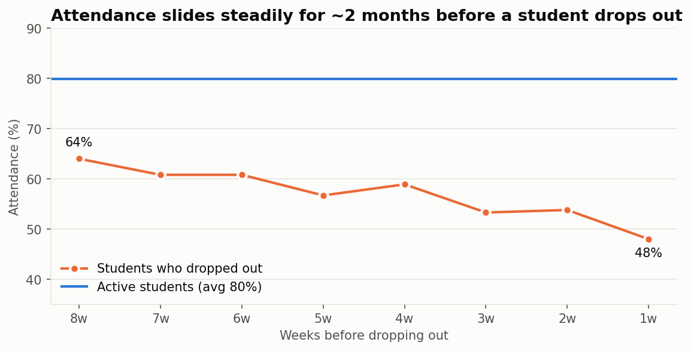
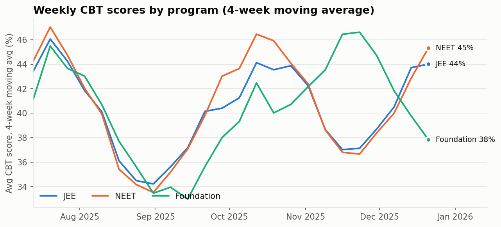

# EdTech Learning Analytics: Student Performance, Engagement & Dropout Risk

An end-to-end data analytics project on a coaching institute's learning platform (JEE / NEET / Foundation batches). It covers **SQL** data modelling and analysis, **Python** statistics and an early-warning model, and an **Excel** dashboard with a **Power BI** build guide. The goal is to find weak topics, measure how attendance and homework affect results, and identify students at risk of dropping out.

**Tools:** SQL (MySQL 8 / SQLite) · Python (Pandas, NumPy, SciPy, scikit-learn, Matplotlib) · Excel (COUNTIFS/AVERAGEIFS, charts, data validation) · Power BI (DAX)

---

## Business questions
1. How are students performing, and **which topics are weakest**?
2. Do **attendance** and **homework** move test scores, and by how much?
3. How do **online vs offline** batches and **teachers** compare?
4. **Who is likely to drop out**, and how early can we spot them?

## Key findings

| # | Finding |
|---|---|
| 1 | All **8 "hard" topics are the bottom 8** by accuracy. Permutations & Combinations, Genetics, Rotational Motion and Probability are at about **50%**. Accuracy drops about 8–9 points per difficulty level. |
| 2 | Students with **90%+ attendance average 46%** on CBTs; those **below 60% average 25%** and have a **47% dropout rate**. |
| 3 | Homework is the strongest engagement signal (**r = 0.55** with score): 80%+ submitters average **50%**, under 40% submitters average **18%**. |
| 4 | **Online** batches attend **5.6 points less** and score **2.8 points lower** than offline (Welch t-test, p < 0.01). |
| 5 | Dropouts are gradual: attendance is already **16 points below** active students **8 weeks before** a student leaves, and falls to **48%** in the final week. |
| 6 | An explainable logistic regression using **only the first 6 weeks** reaches **ROC-AUC 0.74**. Calling the **top 20% highest-risk** students would reach about **half of future dropouts**. |
| 7 | **14 of 18 batches** improved over the term. Four Foundation batches declined and should be reviewed. |






## Recommendations
1. **Targeted revision** for the 8 hard topics: weekly doubt-clearing sessions and extra practice sets.
2. **Automatic parent alerts** when a student's weekly attendance falls below 65%.
3. **Weekly counsellor call list** from the early-warning model (top 20%) or the SQL rule (students with 2+ risk flags).
4. **Homework visibility** on student and parent dashboards, with reminders before due dates.
5. **Online batch engagement**: shorter live sessions and check-ins on recorded lectures.
6. **Teacher peer learning**, led by the top-ranked teacher in each subject.

---

## Dataset
The data is **synthetic**, generated by `scripts/generate_data.py` with a fixed seed so results are reproducible. It's modelled on how a real coaching-institute platform stores CBT, attendance and homework data. All names and schools are fictional.

| Table | Rows | Description |
|---|---:|---|
| students | 1,500 | enrolment, batch, school, join / dropout date |
| batches | 18 | program (JEE/NEET/Foundation), grade, online/offline |
| teachers / batch_subject_teacher | 16 / 60 | who teaches which subject to which batch |
| topics | 32 | subject, topic, difficulty (1–3) |
| tests | 432 | weekly Sunday CBTs (30 questions, 120 marks, +4/−1) |
| test_results | 57,882 | per student, per test, per topic: attempted / correct / wrong / marks |
| attendance | 208,938 | daily Present / Late / Absent (Mon–Sat) |
| homework / homework_submissions | 1,440 / 83,724 | weekly homework and scores |

**Data cleaning** (`scripts/clean_data.py`): removed 25 duplicate result rows, filled 40 missing test times with each student's median, standardised 12 gender codes, and checked the business rules (`correct + wrong = attempted`, marks = 4×correct − wrong).

## SQL highlights (`sql/`)
| File | What it shows |
|---|---|
| `01_schema.sql` | Normalised relational schema with primary/foreign keys and indexes |
| `02_load_data_mysql.sql` | `LOAD DATA LOCAL INFILE` with NULL handling |
| `03_views.sql` | Reporting views: `v_student_test_scores`, `v_student_summary`, `v_topic_performance` |
| `04_analysis_queries.sql` | 13 business questions: **CTEs, window functions** (`RANK`, `DENSE_RANK`, `ROW_NUMBER`, moving average), `CASE` bands, multi-table joins |
| `05_stored_procedures_mysql.sql` | `sp_test_leaderboard`, `sp_student_report`, `sp_at_risk_students` (parameterised) |

Example: 4-week moving average of scores per program
```sql
SELECT program, test_date, avg_score_pct,
       ROUND(AVG(avg_score_pct) OVER (PARTITION BY program ORDER BY test_date
                                      ROWS BETWEEN 3 PRECEDING AND CURRENT ROW), 2) AS moving_avg_4wk
FROM weekly;
```

## Dashboard
- **Excel:** `dashboard/EdTech_Dashboard.xlsx`. KPI tiles and band tables are live `COUNTIFS`/`AVERAGEIFS` formulas driven by **Program** and **Mode** drop-down filters. It includes charts for attendance, homework, weak topics and the weekly trend, plus an at-risk student list.
- **Power BI:** `dashboard/POWER_BI_GUIDE.md`. Covers the star-schema model, DAX measures and report layout.

## Project structure
```
edtech-learning-analytics/
├── data/
│   ├── raw/            # generated CSVs (with deliberate data-quality issues)
│   └── clean/          # cleaned CSVs used for analysis
├── sql/                # schema, views, 13 analysis queries, stored procedures
├── scripts/            # generate → clean → build DB → run queries → Excel dashboard
├── notebooks/
│   └── edtech_analysis.ipynb   # full analysis with charts and model
├── dashboard/          # Excel dashboard + Power BI guide
├── images/             # charts used in this README
└── outputs/            # query results and at-risk student list (CSV)
```

## How to run
```bash
pip install -r requirements.txt
python scripts/generate_data.py        # optional: data is already included
python scripts/clean_data.py
python scripts/build_database.py       # creates data/edtech.db (SQLite)
python scripts/run_queries.py          # runs all 13 SQL questions -> outputs/query_results/
python scripts/build_excel_dashboard.py
jupyter notebook notebooks/edtech_analysis.ipynb
```
To use **MySQL** instead: run `01_schema.sql`, then `02_load_data_mysql.sql`, `03_views.sql` and `05_stored_procedures_mysql.sql`. The queries in `04` are written to run on both MySQL and SQLite; Q11 has a comment with the MySQL date syntax.

## Limitations
- The data is synthetic, so the numbers demonstrate the method, not real outcomes.
- The findings are correlations; an A/B test of interventions would be needed to prove cause and effect.
- The model is kept simple and explainable. A production version would need retraining each term and ongoing monitoring.

---
**Author:** Ronit Kumar · [LinkedIn](https://linkedin.com/in/ronit-kumar-885170247) · kronit528@gmail.com
